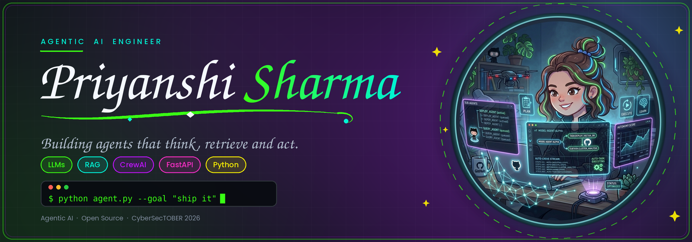
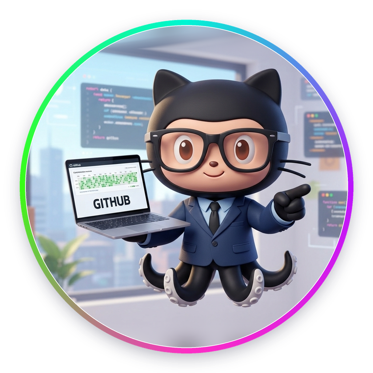
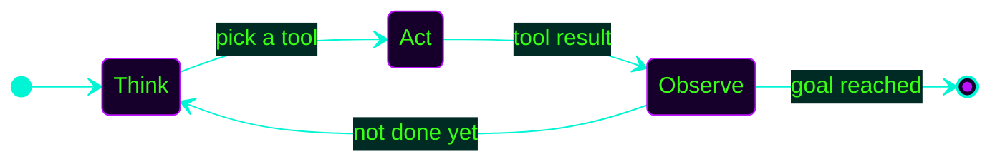
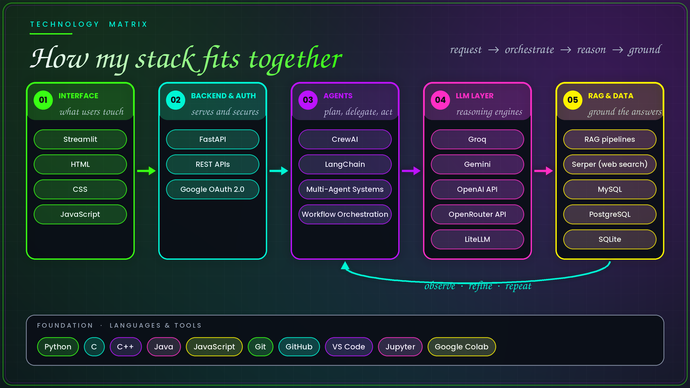
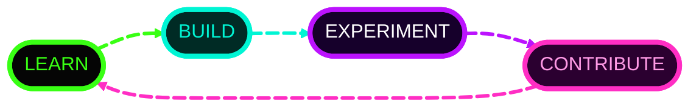

<!--
  PRIYANSHI SHARMA // AGENTIC AI ENGINEER
  Profile README :: github.com/priyanshi17112007
  SETUP: upload the assets/ folder (hero-banner.png + agent-avatar-dark.png + agent-avatar-light.png + tech-matrix.png) next to this README.
-->

<div align="center">




<br/>

<a href="#whoami"></a>
<a href="#loop"></a>
<a href="#projects"></a>
<a href="#skills"></a>
<a href="#cybersectober"></a>
<a href="#telemetry"></a>
<a href="#connect"></a>

<br/><br/>


<br/>

`[ NEURAL CORE: ONLINE ]` &nbsp; `[ AGENT SWARM: DEPLOYED ]` &nbsp; `[ OPEN SOURCE: ON ]`


</div>

<a id="whoami"></a>
## `01 // WHOAMI.exe`

<table>
<tr>
<td valign="middle">

Hey, I'm **Priyanshi Sharma**, an **AI engineer** building autonomous, tool-using systems with **LLMs, RAG, prompt engineering, workflow orchestration and multi-agent systems**.

I'm passionate about intelligent, scalable automation for real-world problems. My focus isn't just *using* AI. It's building the **systems around it**: the planners, retrievers, tools and feedback loops that turn an LLM into an agent.

**Want proof?** My code is in the repositories. 👉 Start with the projects below, or jump straight in:

<a href="#projects"></a>
<a href="https://github.com/priyanshi17112007?tab=repositories"></a>

</td>
<td align="center" valign="middle" width="340">

<a href="#projects">
<picture>
  <source media="(prefers-color-scheme: dark)" srcset="assets/agent-avatar-dark.png">
  <source media="(prefers-color-scheme: light)" srcset="assets/agent-avatar-light.png">
  
</picture>
</a>

</td>
</tr>
</table>

```python
class Priyanshi:
    role      = "AI Engineer | Agentic AI | Python Developer"
    stack     = ["Python", "FastAPI", "CrewAI", "LangChain", "Groq", "Gemini", "RAG"]
    building  = ["Multi-agent systems", "Web-RAG pipelines", "AI wellness apps"]
    learning  = ["Docker", "Advanced DBMS", "Agent evaluation"]
    mindset   = "Learn. Build. Experiment. Contribute."

    def agent_loop(self, goal):
        while not goal.achieved:
            plan   = self.think(goal)     # reason
            result = self.act(plan)       # use tools
            self.observe(result)          # learn from feedback
        return "Turning ideas into intelligent systems."
```

---

<a id="loop"></a>
## `02 // AGENT_LOOP.live()`

> Neon data streams through my agent pipeline. Edges are animated, so watch the flow.

```mermaid
%%{init: {'theme':'base','themeVariables':{'background':'#050505','primaryColor':'#0a0a14','primaryTextColor':'#39FF14','primaryBorderColor':'#39FF14','lineColor':'#00F5D4','secondaryColor':'#16002B','tertiaryColor':'#031A0B','fontFamily':'monospace'},'flowchart':{'curve':'basis'}}}%%
flowchart LR
    U([👩‍💻 USER GOAL]):::human
    P{{🧠 PLANNER AGENT}}:::core
    R[🔎 RESEARCH AGENT<br/>real-time web search]:::agent
    V[(📚 RAG CONTEXT<br/>retrieve + rank)]:::data
    L[⚡ LLM ENGINE<br/>Groq · Gemini · OpenAI]:::llm
    W[✍️ WRITER AGENT]:::agent
    C{✅ QUALITY CHECK}:::core
    O([🚀 ANSWER / ACTION]):::human

    U e1@==> P
    P e2@==> R
    R e3@==> V
    V e4@==> L
    L e5@==> W
    W e6@==> C
    C e7@==>|pass| O
    C e8@-.->|refine| P

    e1@{ animate: true, animation: fast }
    e2@{ animate: true, animation: fast }
    e3@{ animate: true, animation: fast }
    e4@{ animate: true, animation: fast }
    e5@{ animate: true, animation: fast }
    e6@{ animate: true, animation: fast }
    e7@{ animate: true, animation: fast }
    e8@{ animate: true, animation: slow }

    classDef human fill:#050505,stroke:#39FF14,stroke-width:4px,color:#39FF14;
    classDef core fill:#16002B,stroke:#BC13FE,stroke-width:4px,color:#ffffff;
    classDef agent fill:#002B25,stroke:#00F5D4,stroke-width:3px,color:#00F5D4;
    classDef data fill:#0a0a14,stroke:#fff200,stroke-width:3px,color:#fff200;
    classDef llm fill:#2b0030,stroke:#ff2ec4,stroke-width:4px,color:#ff9ae6;

    linkStyle 0 stroke:#39FF14,stroke-width:3px;
    linkStyle 1 stroke:#00F5D4,stroke-width:3px;
    linkStyle 2 stroke:#BC13FE,stroke-width:3px;
    linkStyle 3 stroke:#fff200,stroke-width:3px;
    linkStyle 4 stroke:#ff2ec4,stroke-width:3px;
    linkStyle 5 stroke:#39FF14,stroke-width:3px;
    linkStyle 6 stroke:#00F5D4,stroke-width:3px;
    linkStyle 7 stroke:#BC13FE,stroke-width:3px;
```



<details>
<summary><b>⚡ Think → Act → Observe (the ReAct loop)</b></summary>



</details>

---

<a id="projects"></a>
## `03 // PROJECTS.exe`

<div align="center">

</div>

### 🧠 PROJECT_01 // AUREX — AGENTIC WEB RAG

<details open>
<summary><b>Inspect autonomous web intelligence platform</b></summary>

<br/>

**Aurex** is an end-to-end **web retrieval + augmented generation** platform combining real-time web search, LLMs and multi-agent orchestration.

```mermaid
%%{init: {'theme':'base','themeVariables':{'background':'#050505','primaryColor':'#0a0a14','primaryTextColor':'#39FF14','primaryBorderColor':'#BC13FE','lineColor':'#BC13FE','fontFamily':'monospace'},'flowchart':{'curve':'basis'}}}%%
flowchart LR
    Q([🔍 Query]):::n1 e1@==> API[FastAPI]:::n2
    API e2@==> CREW{{CrewAI agents}}:::n3
    CREW e3@==> S[Serper<br/>real-time search]:::n4
    S e4@==> LLM[LiteLLM → Groq]:::n5
    LLM e5@==> A([✅ Grounded answer]):::n1
    e1@{ animate: true, animation: fast }
    e2@{ animate: true, animation: fast }
    e3@{ animate: true, animation: fast }
    e4@{ animate: true, animation: fast }
    e5@{ animate: true, animation: fast }
    classDef n1 fill:#050505,stroke:#39FF14,stroke-width:3px,color:#39FF14;
    classDef n2 fill:#002B25,stroke:#00F5D4,stroke-width:3px,color:#00F5D4;
    classDef n3 fill:#16002B,stroke:#BC13FE,stroke-width:3px,color:#fff;
    classDef n4 fill:#0a0a14,stroke:#fff200,stroke-width:3px,color:#fff200;
    classDef n5 fill:#2b0030,stroke:#ff2ec4,stroke-width:3px,color:#ff9ae6;
    linkStyle 0 stroke:#39FF14,stroke-width:3px;
    linkStyle 1 stroke:#00F5D4,stroke-width:3px;
    linkStyle 2 stroke:#BC13FE,stroke-width:3px;
    linkStyle 3 stroke:#fff200,stroke-width:3px;
    linkStyle 4 stroke:#ff2ec4,stroke-width:3px;
```



- 🌐 Real-time web retrieval and information gathering
- 🧬 LLM-powered response generation
- 🕸️ Agent orchestration with **CrewAI**
- 🔌 Integrations: **Groq · Serper API · LiteLLM · FastAPI**


<a href="https://github.com/priyanshi17112007/Aurex-AgenticWeb-RAG">

</a>

<a href="https://github.com/priyanshi17112007/Aurex-AgenticWeb-RAG">

</a>

</details>

### 🌿 PROJECT_02 // AURORA MIND — AI WELLNESS & DIGITAL JOURNAL

<details open>
<summary><b>Inspect AI-powered mood tracking & journaling platform</b></summary>

<br/>

An **AI-powered mood tracking and journaling platform** that turns daily entries into personalized **Gemini AI wellness insights**, shown on interactive analytics dashboards.

```mermaid
%%{init: {'theme':'base','themeVariables':{'background':'#050505','primaryColor':'#0a0a14','primaryTextColor':'#00F5D4','primaryBorderColor':'#00F5D4','lineColor':'#00F5D4','fontFamily':'monospace'},'flowchart':{'curve':'basis'}}}%%
flowchart LR
    J([📓 Journal entry]):::n1 e1@==> M[😊 Mood tracking]:::n2
    M e2@==> G{{✨ Gemini AI}}:::n3
    G e3@==> I[💡 Personalized insights]:::n4
    I e4@==> D([📊 Analytics dashboard]):::n1
    e1@{ animate: true, animation: fast }
    e2@{ animate: true, animation: fast }
    e3@{ animate: true, animation: fast }
    e4@{ animate: true, animation: fast }
    classDef n1 fill:#050505,stroke:#39FF14,stroke-width:3px,color:#39FF14;
    classDef n2 fill:#002B25,stroke:#00F5D4,stroke-width:3px,color:#00F5D4;
    classDef n3 fill:#16002B,stroke:#BC13FE,stroke-width:3px,color:#fff;
    classDef n4 fill:#2b0030,stroke:#ff2ec4,stroke-width:3px,color:#ff9ae6;
    linkStyle 0 stroke:#39FF14,stroke-width:3px;
    linkStyle 1 stroke:#00F5D4,stroke-width:3px;
    linkStyle 2 stroke:#BC13FE,stroke-width:3px;
    linkStyle 3 stroke:#ff2ec4,stroke-width:3px;
```



- 🧘 Mood tracking and digital journaling
- ✨ Personalized wellness insights powered by **Gemini**
- 📈 Interactive analytics dashboards


<!-- TODO: replace the URL below with your Aurora Mind repo link -->
<a href="https://github.com/priyanshi17112007?tab=repositories">

</a>

</details>

### 📡 PROJECT_03 // QR_SCAN_PORTFOLIO

<details open>
<summary><b>Inspect QR-powered smart digital profile</b></summary>

<br/>

An **AI-powered QR Code Portfolio** built with **FastAPI**: scan a QR code and get an instant, secure, dynamic profile backed by a cloud database, with a responsive real-time interface.

```mermaid
%%{init: {'theme':'base','themeVariables':{'background':'#050505','primaryColor':'#0a0a14','primaryTextColor':'#39FF14','primaryBorderColor':'#39FF14','lineColor':'#39FF14','fontFamily':'monospace'},'flowchart':{'curve':'basis'}}}%%
flowchart LR
    QR([📱 Scan QR]):::n1 e1@==> F[FastAPI backend]:::n2
    F e2@==> AUTH{{🔐 Secure access}}:::n3
    AUTH e3@==> DB[(☁️ Cloud DB)]:::n4
    DB e4@==> P([⚡ Dynamic profile]):::n1
    e1@{ animate: true, animation: fast }
    e2@{ animate: true, animation: fast }
    e3@{ animate: true, animation: fast }
    e4@{ animate: true, animation: fast }
    classDef n1 fill:#050505,stroke:#39FF14,stroke-width:3px,color:#39FF14;
    classDef n2 fill:#002B25,stroke:#00F5D4,stroke-width:3px,color:#00F5D4;
    classDef n3 fill:#16002B,stroke:#BC13FE,stroke-width:3px,color:#fff;
    classDef n4 fill:#0a0a14,stroke:#fff200,stroke-width:3px,color:#fff200;
    linkStyle 0 stroke:#39FF14,stroke-width:3px;
    linkStyle 1 stroke:#00F5D4,stroke-width:3px;
    linkStyle 2 stroke:#BC13FE,stroke-width:3px;
    linkStyle 3 stroke:#fff200,stroke-width:3px;
```




<a href="https://github.com/priyanshi17112007/QR_SCAN_PORTFOLIO">

</a>

<a href="https://github.com/priyanshi17112007/QR_SCAN_PORTFOLIO">

</a>

</details>

<div align="center">
<a href="https://github.com/priyanshi17112007?tab=repositories">

</a>
</div>

---

<a id="skills"></a>
## `04 // TECHNOLOGY_MATRIX.load()`

<div align="center">



</div>

<details open>
<summary><b>⚡ Animated version of the same flow</b> <sub>(click to collapse)</sub></summary>



</details>

<div align="center">

```mermaid
%%{init: {'theme':'base','themeVariables':{'background':'#050505','primaryColor':'#0a0a14','primaryTextColor':'#ffffff','primaryBorderColor':'#39FF14','lineColor':'#00F5D4','fontFamily':'monospace','clusterBkg':'#0a0a14'},'flowchart':{'curve':'basis','nodeSpacing':28,'rankSpacing':55}}}%%
flowchart LR
    subgraph L1["1 · INTERFACE"]
        A1[Streamlit]:::g
        A2[HTML · CSS · JS]:::g
    end
    subgraph L2["2 · BACKEND & AUTH"]
        B1[FastAPI]:::c
        B2[REST APIs]:::c
        B3[Google OAuth 2.0]:::c
    end
    subgraph L3["3 · AGENTS"]
        C1[CrewAI]:::p
        C2[LangChain]:::p
        C3[Multi-agent<br/>workflows]:::p
    end
    subgraph L4["4 · LLM LAYER"]
        D1[LiteLLM router]:::k
        D2[Groq]:::k
        D3[Gemini]:::k
        D4[OpenAI API]:::k
        D5[OpenRouter]:::k
    end
    subgraph L5["5 · RAG & DATA"]
        E1[RAG pipeline]:::y
        E2[Serper<br/>web search]:::y
        E3[(MySQL · PostgreSQL<br/>SQLite)]:::y
    end

    L1 e1@==> L2
    L2 e2@==> L3
    L3 e3@==> L4
    L4 e4@==> L5
    L5 e5@-.->|observe + refine| L3

    e1@{ animate: true, animation: fast }
    e2@{ animate: true, animation: fast }
    e3@{ animate: true, animation: fast }
    e4@{ animate: true, animation: fast }
    e5@{ animate: true, animation: slow }

    style L1 fill:#031A0B,stroke:#39FF14,stroke-width:3px,color:#39FF14
    style L2 fill:#002B25,stroke:#00F5D4,stroke-width:3px,color:#00F5D4
    style L3 fill:#16002B,stroke:#BC13FE,stroke-width:3px,color:#d9a0ff
    style L4 fill:#2b0030,stroke:#ff2ec4,stroke-width:3px,color:#ff9ae6
    style L5 fill:#2b2600,stroke:#fff200,stroke-width:3px,color:#fff200

    classDef g fill:#050505,stroke:#39FF14,stroke-width:2px,color:#39FF14;
    classDef c fill:#050505,stroke:#00F5D4,stroke-width:2px,color:#00F5D4;
    classDef p fill:#050505,stroke:#BC13FE,stroke-width:2px,color:#d9a0ff;
    classDef k fill:#050505,stroke:#ff2ec4,stroke-width:2px,color:#ff9ae6;
    classDef y fill:#050505,stroke:#fff200,stroke-width:2px,color:#fff200;

    linkStyle 0 stroke:#39FF14,stroke-width:3px;
    linkStyle 1 stroke:#00F5D4,stroke-width:3px;
    linkStyle 2 stroke:#BC13FE,stroke-width:3px;
    linkStyle 3 stroke:#ff2ec4,stroke-width:3px;
    linkStyle 4 stroke:#fff200,stroke-width:3px;
```

### `LANGUAGES // DEV`


### `AI // AGENTS // BACKEND`


### `DATA // NOTEBOOKS // INFRA`


</div>

<details>
<summary><b>▸ FULL SKILL TABLE // EXPAND</b></summary>

| Domain | Technologies |
|---|---|
| Programming | Python, C, C++, Java, HTML, CSS, JavaScript |
| Agentic AI | CrewAI, LangChain, AI agents, multi-agent systems, workflow orchestration |
| LLMs & APIs | OpenAI API, Gemini, Groq, OpenRouter API, LiteLLM, prompt engineering |
| Retrieval | RAG pipelines, Serper API (web search) |
| Backend & auth | FastAPI, Streamlit, REST APIs, Google OAuth 2.0 |
| Databases | MySQL, PostgreSQL, SQLite |
| Tools | Git, GitHub, VS Code, Jupyter, Google Colab |

Logos reflect tools I've used in projects or am learning; they don't imply expert-level proficiency in each.

</details>

---

<a id="cybersectober"></a>
## `05 // CYBERSECTOBER_2026.leaderboard`

<div align="center">


<br/>

<a href="https://cybersectober.github.io/Cybersectober/u/priyanshi17112007/"></a>
<a href="https://cybersectober.github.io/Cybersectober/u/priyanshi17112007/"></a>
<a href="https://cybersectober.github.io/Cybersectober/u/priyanshi17112007/"></a>

<p><b>First Contribution</b> &nbsp;·&nbsp; <b>Security Contributor</b> &nbsp;·&nbsp; <b>AI Security Pioneer</b></p>

<a href="https://cybersectober.github.io/Cybersectober/u/priyanshi17112007/">

</a>

</div>

I believe open source is one of the best ways to learn engineering, exchange ideas, and build software that others can use. My goal: keep learning, contribute meaningfully, and collaborate with developers to create useful technology.

---

<a id="telemetry"></a>
## `06 // GITHUB_TELEMETRY.live()`

<div align="center">


<br/>

### 👁️ PROFILE VIEWS


<br/><br/>


<br/><br/>


</div>

<details>
<summary><b>▸ TELEMETRY NOTES</b></summary>

- **Views today / total:** hitscounter.dev (IST). **Signals detected** is the all-time komarev counter.
- **Stats, languages and streak** are generated live from my GitHub account by third-party services, so new commits, PRs and contributions show up automatically after their short cache window (a few hours at most).

</details>

---

<a id="connect"></a>
## `07 // CONNECT_TO_NETWORK`

<div align="center">


<a href="https://github.com/priyanshi17112007">

</a>
<a href="https://github.com/priyanshi17112007?tab=repositories">

</a>
<a href="https://www.linkedin.com/in/priyanshi-sharma-27a715338/">

</a>

<br/><br/>




<sub>DESIGNED IN THE DARK // POWERED BY CURIOSITY // BUILT WITH AI</sub>

</div>
