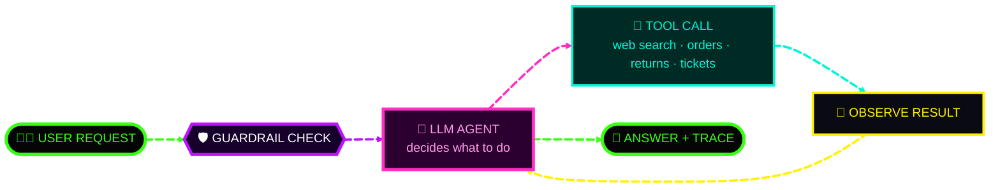
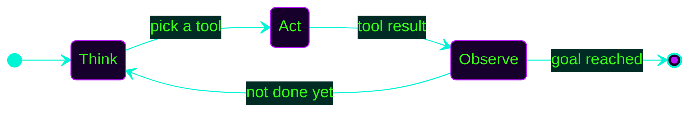
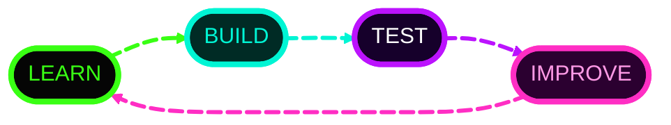

<!--
  PRIYANSHI SHARMA // 3RD-YEAR ENGINEERING STUDENT // AGENTIC AI + PYTHON BACKEND
  Profile README :: github.com/priyanshi17112007
  SETUP: upload assets/hero-banner.png + assets/agent-avatar-dark.png + assets/agent-avatar-light.png next to this README.
  (tech-matrix.png is no longer used. The skills section is built from live badges and diagrams.)
-->

<div align="center">


<br/>

<a href="#whoami"></a>
<a href="#loop"></a>
<a href="#projects"></a>
<a href="#skills"></a>
<a href="#proof"></a>
<a href="#dsa"></a>
<a href="#telemetry"></a>
<a href="#connect"></a>

<br/><br/>


<br/>

`[ STUDENT: 3RD YEAR ]` &nbsp; `[ AGENTS: BUILDING ]` &nbsp; `[ OPEN SOURCE: ON ]`


</div>

<a id="whoami"></a>
## `01 // WHOAMI.exe`

<table>
<tr>
<td valign="middle">

Hey, I'm **Priyanshi Sharma**, a **3rd-year engineering student** at Arya College of Engineering, Jaipur, focused on **agentic AI and Python backend development**.

I like projects where an LLM doesn't just answer, but **searches the web or calls tools to get something done**, wrapped in a proper API. Everything below is code you can open, run and judge.

**Looking for:** internships and entry-level roles in **LLM applications, agentic AI and Python backend**.

<a href="#projects"></a>
<a href="https://github.com/priyanshi17112007?tab=repositories"></a>

</td>
<td align="center" valign="middle" width="340">

<a href="#projects">
<picture>
  <source media="(prefers-color-scheme: dark)" srcset="assets/agent-avatar-dark.png">
  <source media="(prefers-color-scheme: light)" srcset="assets/agent-avatar-light.png">
  
</picture>
</a>

</td>
</tr>
</table>

| | |
|---|---|
| **Education** | B.Tech, 3rd year, Arya College of Engineering, Jaipur |
| **Focus** | Agentic AI, LLM applications, REST APIs |
| **Building now** | Citations and better retrieval for Aurex |
| **Learning next** | Vector databases, LangGraph, LLM evaluation, MCP |
| **Problem solving** | LeetCode in Python, Java and C++ |

```python
class Priyanshi:
    status    = "3rd-year engineering student, Jaipur"
    focus     = ["Agentic AI", "LLM apps", "Python backend (FastAPI)"]
    shipped   = ["Aurex (web RAG agent)", "ResolveAI (support agent)", "QR Scan Portfolio"]
    learning  = ["Vector DBs", "LangGraph", "LLM evaluation", "MCP", "CI/CD"]
    mindset   = "Learn. Build. Test. Improve."

    def agent_loop(self, goal):
        while not goal.achieved:
            plan   = self.think(goal)     # reason
            result = self.act(plan)       # call a tool
            self.observe(result)          # check the result
        return "Ship it, then make it better."
```

---

<a id="loop"></a>
## `02 // AGENT_LOOP.live()`

> The pattern behind my agent projects. Edges are animated, so watch the flow.



<details>
<summary><b>⚡ Think → Act → Observe (the ReAct loop)</b></summary>



</details>

---

<a id="projects"></a>
## `03 // PROJECTS.exe`

<div align="center">

</div>

### 🧠 PROJECT_01 // AUREX — AGENTIC WEB RAG

<details open>
<summary><b>Inspect web-search agent platform</b></summary>

<br/>

**Aurex** answers questions using the live web. It searches through Serper, and a CrewAI agent writes a response grounded in those results, served by a FastAPI backend with a web UI and a CLI client.

```mermaid
%%{init: {'theme':'base','themeVariables':{'background':'#050505','primaryColor':'#0a0a14','primaryTextColor':'#39FF14','primaryBorderColor':'#BC13FE','lineColor':'#BC13FE','fontFamily':'monospace'},'flowchart':{'curve':'basis'}}}%%
flowchart LR
    Q([🔍 Query]):::n1 e1@==> API[FastAPI]:::n2
    API e2@==> S[Serper<br/>real-time search]:::n4
    S e3@==> CREW{{CrewAI agent}}:::n3
    CREW e4@==> LLM[LiteLLM → Groq]:::n5
    LLM e5@==> A([✅ Grounded answer]):::n1
    e1@{ animate: true, animation: fast }
    e2@{ animate: true, animation: fast }
    e3@{ animate: true, animation: fast }
    e4@{ animate: true, animation: fast }
    e5@{ animate: true, animation: fast }
    classDef n1 fill:#050505,stroke:#39FF14,stroke-width:3px,color:#39FF14;
    classDef n2 fill:#002B25,stroke:#00F5D4,stroke-width:3px,color:#00F5D4;
    classDef n3 fill:#16002B,stroke:#BC13FE,stroke-width:3px,color:#fff;
    classDef n4 fill:#0a0a14,stroke:#fff200,stroke-width:3px,color:#fff200;
    classDef n5 fill:#2b0030,stroke:#ff2ec4,stroke-width:3px,color:#ff9ae6;
    linkStyle 0 stroke:#39FF14,stroke-width:3px;
    linkStyle 1 stroke:#00F5D4,stroke-width:3px;
    linkStyle 2 stroke:#BC13FE,stroke-width:3px;
    linkStyle 3 stroke:#fff200,stroke-width:3px;
    linkStyle 4 stroke:#ff2ec4,stroke-width:3px;
```



- 🌐 Real-time web retrieval for fresh answers
- 🕸️ Agent orchestration with **CrewAI**
- 🔌 REST API with Swagger docs · **Groq · Serper · LiteLLM · FastAPI**
- 🧭 **Next:** source citations, streaming, ChromaDB retrieval, evaluation set


<a href="https://github.com/priyanshi17112007/Aurex-AgenticWeb-RAG">

</a>

<a href="https://github.com/priyanshi17112007/Aurex-AgenticWeb-RAG">

</a>

</details>

### 🤖 PROJECT_02 // RESOLVEAI — AI CUSTOMER SUPPORT AGENT

<details open>
<summary><b>Inspect tool-calling support agent</b></summary>

<br/>

Built for the **Domain Verse 1.0 Agentic AI Hackathon**. The agent reads a customer message, screens it for prompt injection, picks the right tool (order, return, payment, ticket, history), runs it on mock data and records an execution trace. The repo includes a test suite.

```mermaid
%%{init: {'theme':'base','themeVariables':{'background':'#050505','primaryColor':'#0a0a14','primaryTextColor':'#39FF14','primaryBorderColor':'#39FF14','lineColor':'#ff2ec4','fontFamily':'monospace'},'flowchart':{'curve':'basis'}}}%%
flowchart LR
    M([💬 Customer message]):::n1 e1@==> G{{🛡️ Guardrails}}:::n3
    G e2@==> A[🧠 LLM agent]:::n5
    A e3@==> T[🔧 Pick a tool]:::n2
    T e4@==> R([✅ Reply + trace]):::n1
    e1@{ animate: true, animation: fast }
    e2@{ animate: true, animation: fast }
    e3@{ animate: true, animation: fast }
    e4@{ animate: true, animation: fast }
    classDef n1 fill:#050505,stroke:#39FF14,stroke-width:3px,color:#39FF14;
    classDef n2 fill:#002B25,stroke:#00F5D4,stroke-width:3px,color:#00F5D4;
    classDef n3 fill:#16002B,stroke:#BC13FE,stroke-width:3px,color:#fff;
    classDef n5 fill:#2b0030,stroke:#ff2ec4,stroke-width:3px,color:#ff9ae6;
    linkStyle 0 stroke:#39FF14,stroke-width:3px;
    linkStyle 1 stroke:#BC13FE,stroke-width:3px;
    linkStyle 2 stroke:#ff2ec4,stroke-width:3px;
    linkStyle 3 stroke:#00F5D4,stroke-width:3px;
```



- 🔧 Separate tools for orders, returns, payments, tickets and history
- 🛡️ Guardrails against prompt-injection and jailbreak attempts
- 🧪 Tests included · 🧭 **Next:** PostgreSQL, adversarial test set, MCP server


<a href="https://github.com/priyanshi17112007/AI_CUSTOMER_SUPPORT_AGENT">

</a>

<a href="https://github.com/priyanshi17112007/AI_CUSTOMER_SUPPORT_AGENT">

</a>

</details>

### 📡 PROJECT_03 // QR_SCAN_PORTFOLIO

<details open>
<summary><b>Inspect QR-powered smart digital profile</b></summary>

<br/>

A **QR code portfolio** built with **FastAPI**: scan a QR code and get an instant, dynamic profile loaded from a cloud database, with a Dockerfile for repeatable setup.


<a href="https://github.com/priyanshi17112007/QR_SCAN_PORTFOLIO">

</a>

<a href="https://github.com/priyanshi17112007/QR_SCAN_PORTFOLIO">

</a>

</details>

### 🌿 PROJECT_04 // AURORA MIND — AI WELLNESS & DIGITAL JOURNAL

<details>
<summary><b>Inspect mood tracking & journaling platform</b></summary>

<br/>

A **mood tracking and journaling platform** that turns daily entries into personalized **Gemini wellness insights**, shown on analytics dashboards.

```mermaid
%%{init: {'theme':'base','themeVariables':{'background':'#050505','primaryColor':'#0a0a14','primaryTextColor':'#00F5D4','primaryBorderColor':'#00F5D4','lineColor':'#00F5D4','fontFamily':'monospace'},'flowchart':{'curve':'basis'}}}%%
flowchart LR
    J([📓 Journal entry]):::n1 e1@==> M[😊 Mood tracking]:::n2
    M e2@==> G{{✨ Gemini}}:::n3
    G e3@==> I[💡 Insights]:::n4
    I e4@==> D([📊 Dashboard]):::n1
    e1@{ animate: true, animation: fast }
    e2@{ animate: true, animation: fast }
    e3@{ animate: true, animation: fast }
    e4@{ animate: true, animation: fast }
    classDef n1 fill:#050505,stroke:#39FF14,stroke-width:3px,color:#39FF14;
    classDef n2 fill:#002B25,stroke:#00F5D4,stroke-width:3px,color:#00F5D4;
    classDef n3 fill:#16002B,stroke:#BC13FE,stroke-width:3px,color:#fff;
    classDef n4 fill:#2b0030,stroke:#ff2ec4,stroke-width:3px,color:#ff9ae6;
    linkStyle 0 stroke:#39FF14,stroke-width:3px;
    linkStyle 1 stroke:#00F5D4,stroke-width:3px;
    linkStyle 2 stroke:#BC13FE,stroke-width:3px;
    linkStyle 3 stroke:#ff2ec4,stroke-width:3px;
```




<!-- TODO: upload Aurora Mind to GitHub, then replace the link below with its repo URL. Until then this button opens your repositories page. -->
<a href="https://github.com/priyanshi17112007?tab=repositories">

</a>

</details>

**More from my fundamentals:** GitHub Profile Analyzer (Python) · ATM Management System (C) · SFML Chess (C++)

<div align="center">
<a href="https://github.com/priyanshi17112007?tab=repositories">

</a>
</div>

---

<a id="skills"></a>
## `04 // TECHNOLOGY_MATRIX.load()`

> Grouped by how much evidence sits behind each one. Animated edges show how the layers connect in my projects.

```mermaid
%%{init: {'theme':'base','themeVariables':{'background':'#050505','primaryColor':'#0a0a14','primaryTextColor':'#ffffff','primaryBorderColor':'#39FF14','lineColor':'#00F5D4','fontFamily':'monospace','clusterBkg':'#0a0a14'},'flowchart':{'curve':'basis','nodeSpacing':28,'rankSpacing':55}}}%%
flowchart LR
    subgraph L1["1 · INTERFACE"]
        A1[HTML · CSS · JS]:::g
        A2[Streamlit]:::g
    end
    subgraph L2["2 · BACKEND"]
        B1[FastAPI]:::c
        B2[Flask]:::c
        B3[REST APIs]:::c
    end
    subgraph L3["3 · AGENTS"]
        C1[CrewAI]:::p
        C2[Tool calling]:::p
        C3[Guardrails]:::p
    end
    subgraph L4["4 · LLM LAYER"]
        D1[LiteLLM]:::k
        D2[Groq]:::k
        D3[Gemini]:::k
    end
    subgraph L5["5 · DATA & RETRIEVAL"]
        E1[Serper<br/>web search]:::y
        E2[(MySQL · PostgreSQL<br/>SQLite)]:::y
        E3[Next: ChromaDB]:::n
    end

    L1 e1@==> L2
    L2 e2@==> L3
    L3 e3@==> L4
    L4 e4@==> L5
    L5 e5@-.->|observe + refine| L3

    e1@{ animate: true, animation: fast }
    e2@{ animate: true, animation: fast }
    e3@{ animate: true, animation: fast }
    e4@{ animate: true, animation: fast }
    e5@{ animate: true, animation: slow }

    style L1 fill:#031A0B,stroke:#39FF14,stroke-width:3px,color:#39FF14
    style L2 fill:#002B25,stroke:#00F5D4,stroke-width:3px,color:#00F5D4
    style L3 fill:#16002B,stroke:#BC13FE,stroke-width:3px,color:#d9a0ff
    style L4 fill:#2b0030,stroke:#ff2ec4,stroke-width:3px,color:#ff9ae6
    style L5 fill:#2b2600,stroke:#fff200,stroke-width:3px,color:#fff200

    classDef g fill:#050505,stroke:#39FF14,stroke-width:2px,color:#39FF14;
    classDef c fill:#050505,stroke:#00F5D4,stroke-width:2px,color:#00F5D4;
    classDef p fill:#050505,stroke:#BC13FE,stroke-width:2px,color:#d9a0ff;
    classDef k fill:#050505,stroke:#ff2ec4,stroke-width:2px,color:#ff9ae6;
    classDef y fill:#050505,stroke:#fff200,stroke-width:2px,color:#fff200;
    classDef n fill:#050505,stroke:#8A8A8A,stroke-width:2px,stroke-dasharray:4 3,color:#8A8A8A;

    linkStyle 0 stroke:#39FF14,stroke-width:3px;
    linkStyle 1 stroke:#00F5D4,stroke-width:3px;
    linkStyle 2 stroke:#BC13FE,stroke-width:3px;
    linkStyle 3 stroke:#ff2ec4,stroke-width:3px;
    linkStyle 4 stroke:#fff200,stroke-width:3px;
```



<div align="center">

### `LANGUAGES // DEV`


### `USED IN MY PROJECTS`


### `DATA // NOTEBOOKS`


### `LEARNING NEXT`


</div>

<details>
<summary><b>▸ FULL SKILL TABLE // EXPAND</b></summary>

| Level | Technologies |
|---|---|
| **Used in my projects** | Python, FastAPI, Flask, Streamlit, CrewAI, LiteLLM, Groq, Gemini, Serper API, Docker, Git/GitHub, REST APIs |
| **Comfortable with the basics** | C, C++, Java, HTML, CSS, JavaScript, MySQL, PostgreSQL, SQLite, data structures and algorithms |
| **Explored** | LangChain, OpenAI API, OpenRouter, Google OAuth 2.0 |
| **Learning next** | ChromaDB / pgvector, LangGraph, RAG evaluation, MCP, GitHub Actions CI |

</details>

---

<a id="proof"></a>
## `05 // CREDENTIALS.verify()`

<div align="center">


<br/>

<a href="https://cybersectober.github.io/Cybersectober/u/priyanshi17112007/"></a>
<a href="https://cybersectober.github.io/Cybersectober/u/priyanshi17112007/"></a>
<a href="https://cybersectober.github.io/Cybersectober/u/priyanshi17112007/"></a>

<p><b>First Contribution</b> &nbsp;·&nbsp; <b>Security Contributor</b> &nbsp;·&nbsp; <b>AI Security Pioneer</b></p>

<a href="https://cybersectober.github.io/Cybersectober/u/priyanshi17112007/">

</a>
<a href="https://www.skills.google/public_profiles/ee5b2ca6-3fe6-4af8-a159-8e9b13807e34">

</a>
<a href="https://www.credly.com/users/priyanshi-sharma.56c4bef3">

</a>

</div>

I believe open source is one of the best ways to learn engineering, exchange ideas, and build software that others can use. My goal: keep learning, contribute meaningfully, and collaborate with developers to create useful technology.

---

<a id="dsa"></a>
## `06 // PROBLEM_SOLVING.run()`

<div align="center">


<br/>

<a href="https://leetcode.com/u/erpriyanshisharma_15/">

</a>

</div>

| | |
|---|---|
| **Languages used** | Python (49 solved) · Java (21) · C++ (7) |
| **Topics practiced** | Arrays, Strings, Two Pointers, Hash Tables, Math, Trees, Dynamic Programming, Backtracking, Divide and Conquer |
| **Why it matters to me** | Clean data-structure thinking makes my agent and backend code faster and easier to debug |

---

<a id="telemetry"></a>
## `07 // GITHUB_TELEMETRY.live()`

<div align="center">


<br/>

### 👁️ PROFILE VIEWS


<br/><br/>


<br/><br/>


</div>

<details>
<summary><b>▸ TELEMETRY NOTES</b></summary>

- **Views today / total:** hitscounter.dev (IST). **Signals detected** is the all-time komarev counter.
- **Stats, languages, streak and LeetCode card** are generated live by third-party services, so new activity shows up automatically after a short cache window (a few hours at most). If one shows an error, it is usually that service being busy; refresh later.

</details>

---

<a id="connect"></a>
## `08 // CONNECT_TO_NETWORK`

<div align="center">


<a href="https://github.com/priyanshi17112007">

</a>
<a href="https://www.linkedin.com/in/priyanshi-sharma-27a715338/">

</a>
<a href="https://leetcode.com/u/erpriyanshisharma_15/">

</a>
<a href="https://www.skills.google/public_profiles/ee5b2ca6-3fe6-4af8-a159-8e9b13807e34">

</a>
<!-- TODO: add your email, then remove the comment markers around the next line
<a href="mailto:YOUR_EMAIL"></a>
-->
<!-- TODO: add your resume link (Google Drive, "anyone with the link"), then remove the comment markers around the next line
<a href="YOUR_RESUME_LINK"></a>
-->

<br/><br/>




<sub>DESIGNED IN THE DARK // POWERED BY CURIOSITY // BUILT WITH AI</sub>

</div>
